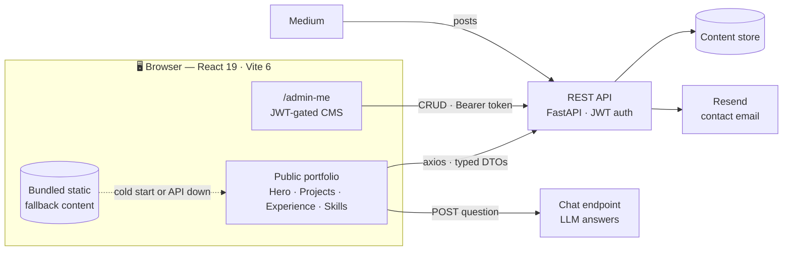

<div align="center">


<br/>

[](https://alkairis.github.io)
[](https://www.linkedin.com/in/alkairis/)
[](https://alkairis.medium.com)
[](https://x.com/alkairis_)

<br/>

> ### *Shipping RAG pipelines, agentic workflows, and cloud-native systems that solve real problems at scale.*

</div>

---

## 🧠 whoami

**Deepak Singh Rajput** — Data Engineer + AI Engineer, India (hybrid) · IST (UTC+5:30).

Four-plus years at [Impetus Technologies](https://www.impetus.com/) building cloud data platforms on BigQuery and Dataproc, and the **production** Generative AI that runs on them — retrieval pipelines that stay accurate on real corpora and agentic LLM workflows that don't fall over on the third tool call. **GCP Generative AI Leader certified.**

The parts I care about: grounding retrieval so it actually retrieves, keeping agent graphs debuggable, and the unglamorous cost/latency/reliability work that decides whether an LLM feature survives contact with production.

| Domain | Stack |
|---|---|
| 🤖 **GenAI** | LangChain · LangGraph · RAG pipelines · Agentic workflows · Function calling · Prompt engineering · Vector embeddings · LangSmith · MCP · Hugging Face · Ollama |
| 🧮 **Vector & Data** | FAISS · Chroma · Pinecone · PostgreSQL · MySQL · MongoDB · Redis |
| ☁️ **Cloud** | BigQuery · Dataproc · Cloud Composer · Cloud Run · GCS · Artifact Registry · Cloud Functions · Cloud Secrets · AWS |
| 🐍 **Languages** | Python (OOP · async) · TypeScript · SQL |
| ⚙️ **Frameworks** | FastAPI · Pydantic · REST · React |
| 🔧 **DevOps** | Terraform · Docker · Git · uv |

**Awards** — Excellence Award, Transformational Performance (Impetus, 2026) · iAppreciate Award (Impetus, 2026)

**Certifications** — GCP Generative AI Leader (Google Cloud, 2025) · HuggingFace AI Agents (2025) · GenAI Fundamentals (Databricks, 2024) · Associate Cloud Engineer (Google Cloud, 2023)

---

## 🏗️ This repo: the portfolio as a system

Most portfolios are a static page with the content hardcoded in JSX. This one is a **React front end over a real REST API**, with its own JWT-gated CMS — so updating a project or a certification is a form submission, not a commit and redeploy.



> **Note** — the API and the chat endpoint are separate services and aren't in this repo. Without the API the front end falls back to bundled static content, and without the chat endpoint the ghost says it isn't connected yet, so `npm run dev` works standalone.

---

## 🛠️ Stack

<div align="center">


</div>

- **Rendering**: React 19, Vite 6, and client-side routing via React Router 7 (`/`, `/resume`, and the CMS routes).
- **Styling**: hand-written CSS on a small token system. Jet black and lavender-white themes, Royal Amethyst and Electric Cyan accents, Geist for text, Geist Mono for data and Instrument Serif for emphasis. Fonts are self-hosted through Fontsource, so the page makes no third-party font requests.
- **The ghost**: a floating assistant whose eyes follow the cursor (or your finger, on phones). Click it, or press `⌘K` / `Ctrl+K` / `/`, to open the AI menu:
  - **Ask**: a question goes to the LLM chat endpoint (see [Ghost chat API](#-ghost-chat-api)). While it answers, the ghost plays a "BOO!" animation. Answers render basic markdown (paragraphs, lists, bold, code, links).
  - **Command palette**: the same list offers "Try asking" questions plus Go to, Actions and Elsewhere shortcuts, filtered as you type. Arrow keys move and Enter runs.
  - **Hero console**: the hero's console sends questions to the same endpoint.
- **Opening**: a once-per-session preloader. The ghost sits in an amethyst orb over a 24-chunk meter, then the screen collapses into the corner where the ghost lives.
- **Scroll motion**: scroll-linked animation driven by `data-fx*` attributes (`useScrollFx`). Projects ride a pinned horizontal track on wide screens. A custom scroll rail replaces the browser scrollbar. With reduced motion everything stays still.
- **Selected work**: "Systems I've shipped" shows the first four active projects from `/api/projects`, in the API's order. Each card uses the project's name, description, technologies, image, and GitHub and demo links. Projects without an image get a monogram cover. Any remaining projects are listed under "More projects".
- **Toolbox**: skills from `/api/technical-skills`, grouped by `skill_type`. A skill's optional `sub_tech` list shows on its chip, for example `Google Cloud │ BigQuery · Dataproc · Vertex AI +3`. Hover, focus or tap opens a card with the description and every sub-technology.
- **About**: the ghost logo as a portrait panel. Its eyes track the cursor, and clicking it opens the AI menu.
- **Brand & meta**: the ghost logo in `public/` (SVG favicon, PNG and Apple touch icons, maskable PWA icons, web manifest), a 1200×630 Open Graph card, and JSON-LD `Person` data.
- **State & data**: Zustand stores and module-cached resource hooks with in-flight request de-duplication. The axios client uses JWT interceptors. Every section has bundled fallback content for API cold starts.
- **Resume**: `/resume` renders the same CMS data as a printable page. Its print stylesheet produces a clean A4 PDF.
- **CI/CD**: on every push to `main`, GitHub Actions runs `npm ci`, ESLint, `tsc --noEmit` and the build, then deploys to GitHub Pages.

---

## 👻 Ghost chat API

The ghost doesn't hold any model or context in the browser. It posts each question to the URL in `VITE_CHATBOT_API_URL`, and the backend does the retrieval and the LLM call.

```http
POST $VITE_CHATBOT_API_URL
Content-Type: application/json

{ "message": "Is he open to new roles?" }
```

The reply can be JSON with the answer under any of `reply`, `answer`, `message`, `response`, `output` or `text`, or a plain-text body:

```json
{ "reply": "Yes, Deepak is open to senior data and AI engineering roles…" }
```

- **Timeout**: requests time out after 45 s.
- **Cancellation**: asking again cancels the request in flight.
- **Errors**: a failed request, a non-2xx status or an empty reply shows a friendly error with **Try again** and a link to Contact.
- **Not configured**: if the variable isn't set, the ghost says its answering service isn't connected yet.
- **CORS**: the endpoint must allow requests from the site's origin.

---

## 🚀 Running it locally

```bash
git clone https://github.com/alkairis/alkairis.github.io.git
cd alkairis.github.io
npm install
npm run dev          # http://localhost:5173
```

| Script | What it does |
|---|---|
| `npm run dev` | Vite dev server, proxying `/api` and `/blog` to `localhost:8080` |
| `npm run build` | Production build to `dist/` |
| `npm run typecheck` | `tsc --noEmit` over the TypeScript layer |
| `npm run lint` | ESLint, including the React Hooks rules |
| `npm run preview` | Serve the production build locally |

Without a backend running, every section falls back to its bundled content — so the site is fully browsable out of the box.

<details>
<summary><b>Environment variables</b> (all optional — the app tolerates missing values; in CI they come from GitHub repo variables)</summary>

<br/>

| Variable | Purpose | Default |
|---|---|---|
| `VITE_API_BASE_URL` | Backend origin | `/` (same-origin; dev proxies to `:8080`) |
| `VITE_API_TIMEOUT_MS` | Request timeout | `15000` |
| `VITE_CHATBOT_API_URL` | The ghost's LLM chat endpoint (see [Ghost chat API](#-ghost-chat-api)) | unset: the ghost says it isn't connected |
| `VITE_BASE` | Public base path override | `/` |

</details>

---

## 📁 Layout

```text
src/
├─ api/          typed axios client: DTOs, domain types, JWT interceptors
├─ content/      what the CMS doesn't model: headline profile facts
├─ sections/     home-page sections (Hero, Work, Experience, Toolbox, …)
├─ components/   nav, ghost + AI menu, ask console, Boo loader, preloader, skill cards, icons
├─ lib/          LLM ask client, skill grouping, style helpers
├─ hooks/        shared data hooks (module-cached), ask state, eye tracking, scroll motion
├─ stores/       Zustand stores: theme, blog, assistant
├─ constants/    static fallback content and social-icon mapping
├─ styles/       site and resume (screen + print) stylesheets
└─ pages/        /resume, plus the JWT-gated admin CMS routes
```

---

## 📝 License

[MIT](LICENSE) — use it as reference or inspiration, but please don't deploy it as-is with my name, photo, or personal content. Build your own story.

<div align="center">
<br/>

**Built with ☕ and too many `console.log`s**

[](https://alkairis.github.io)

*If this was useful, a ⭐ goes a long way.*

</div>
